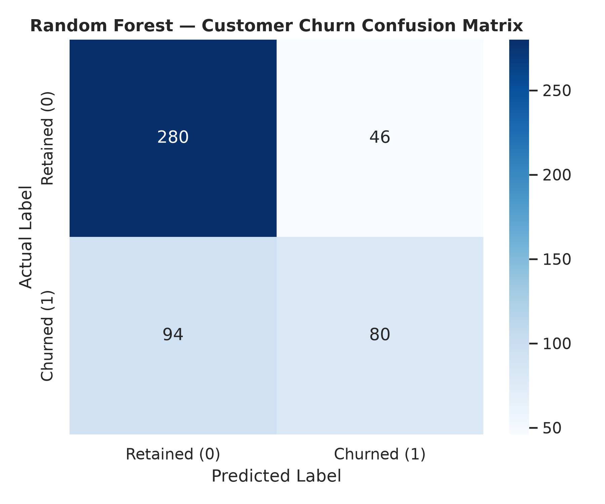
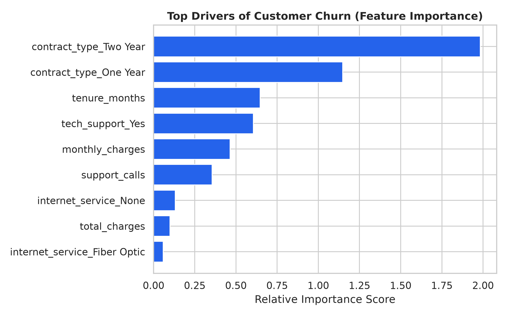

# customer-churn-ml-pipeline
# 📊 Telecom Customer Churn Prediction (End-to-End ML Pipeline)

An end-to-end Machine Learning classification pipeline built with **Python** and **Scikit-Learn** to identify customers at high risk of churning and uncover the key business drivers behind customer attrition.

---

### 🎯 Business Problem
Acquiring a new telecom customer costs significantly more than retaining an existing one. By predicting which subscribers are likely to cancel their service based on contract type, tenure, billing, and customer support history, retention teams can intervene early with targeted offers.

---

### ⚙️ Pipeline Architecture
1. **Data Generation & Validation:** Produces a structured 2,500-customer telecom dataset with realistic behavioral correlations (`tenure_months`, `monthly_charges`, `support_calls`, `contract_type`, `internet_service`, `tech_support`).
2. **Preprocessing Pipeline (`ColumnTransformer`):**
   - **Numerical Features:** Standardized using `StandardScaler`.
   - **Categorical Features:** Encoded using `OneHotEncoder(drop="first")` to prevent multicollinearity.
3. **Model Benchmarking:** Evaluates and compares **Logistic Regression** (interpretable baseline) against a **Random Forest Classifier** using Accuracy, Precision, Recall, F1-Score, and **ROC-AUC**.
4. **Automated Visual Reporting:** Generates high-resolution confusion matrix and feature importance charts inside `outputs/`.

---

### 📈 Key Insights & Visualizations
Once you run the script, the generated charts highlight the primary churn drivers:
- **Contract Type & Tenure:** Month-to-month subscribers in their first 12 months show the highest churn probability.
- **Support Friction:** Frequent customer support calls strongly correlate with upcoming cancellations.

| Confusion Matrix | Feature Importance |
| :---: | :---: |
|  |  |

---

### 🚀 How to Run Locally

1. **Clone the repository:**
   ```bash
   git clone [https://github.com/YOUR_GITHUB_USERNAME/customer-churn-ml-pipeline.git](https://github.com/YOUR_GITHUB_USERNAME/customer-churn-ml-pipeline.git)
   cd customer-churn-ml-pipeline